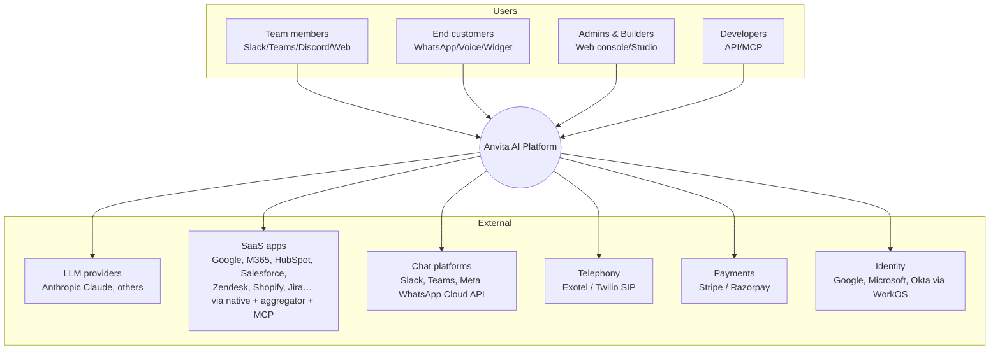
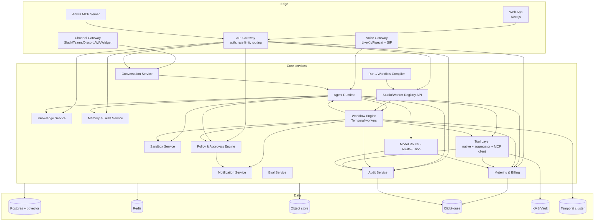
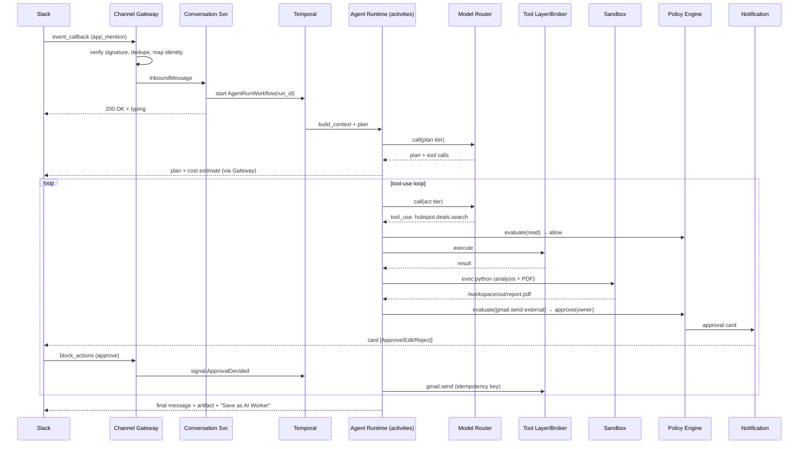
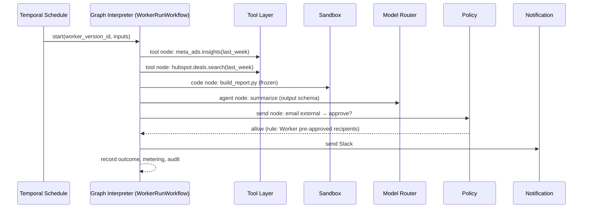
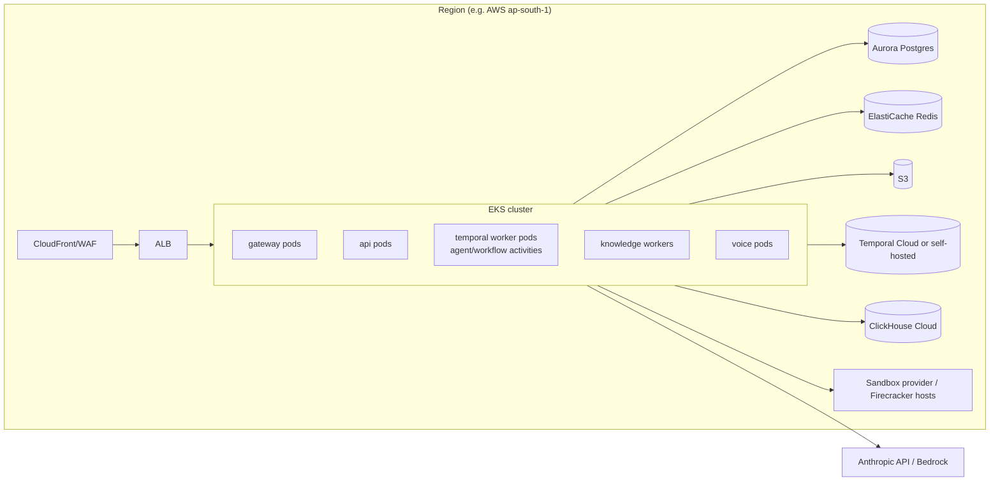

# Anvita AI — Technical Architecture (v0.1)

> Companion to `docs/user-journeys.md` and `docs/anvita-ai-product-spec.md`. It describes the
> target architecture for MVP → Enterprise, with the decisions behind it. Sections marked
> **[MVP]** are built first; **[P1]** and **[P2]** follow the roadmap phases.

## 1. Architectural principles

1. **Two execution modes, one runtime.** Free-form *agent runs* (Viktor) and deterministic *workflow runs* (Ema) share the same tools, policies, memory, metering and audit. A run can be compiled into a workflow.
2. **Durable by default.** Every run is a durable workflow (Temporal), so it can pause for auth, approval or credits for minutes or days and resume exactly where it stopped.
3. **Tenant isolation everywhere.** `workspace_id` on every row, Postgres row-level security, per-workspace sandboxes, and per-tenant encryption keys for secrets.
4. **Policy before side effects.** No tool call with side effects runs without passing the Policy Engine.
5. **Model-agnostic, Claude-first.** All LLM calls go through the Model Router. Claude is the default, and BYO or open models are possible for residency and air-gapped deployments.
6. **Buy commodity, build the core.** Buy auth, integrations aggregator, sandbox (initially), telephony and billing. Build the agent runtime, compiler, workflow engine semantics, policy engine and Studio.
7. **Observable and evaluable.** Every step is traced (OpenTelemetry) and replayable, and feeds evals.

## 2. System context (C4 level 1)



## 3. Container view (C4 level 2)



## 4. Services in detail

### 4.1 Channel Gateway [MVP: Slack + Web; P1: Teams, WhatsApp, GChat, Discord, Widget]
- **Responsibilities:** receive platform events (Slack Events API / Socket Mode, Bot Framework for Teams, Meta WhatsApp Cloud API webhooks, widget WebSocket); verify signatures; deduplicate (idempotency key = platform event id); map platform identities → `user_id` / `external_contact_id`; normalize to a canonical `InboundMessage`; render outbound `OutboundMessage` (text, blocks, cards, files, approval buttons) per platform.
- **Adapters** implement `ChannelAdapter { parseInbound, sendMessage, updateMessage, sendApprovalCard, uploadFile, typingIndicator }`.
- **Streaming:** Slack and Teams use message updates throttled to about 1 per second; Web uses SSE or WebSocket; WhatsApp sends discrete messages (no edits), respecting the 24-hour session window and template messages outside it.
- **Stack:** TypeScript (Fastify), Redis streams for fan-out and back-pressure.

### 4.2 Conversation Service [MVP]
- Owns `conversations`, `messages`, `threads` and attachments; decides **what handles a message**: the generalist agent (Explore), a bound Worker (e.g. the WhatsApp number → Support Worker), or a pending run awaiting input (a reply to a clarifying question).
- Starts a run by launching a Temporal workflow `AgentRunWorkflow(run_id)` and returns immediately (ack < 2 s).

### 4.3 Agent Runtime [MVP]
The Viktor-style brain: a **tool-use loop** running inside a Temporal workflow, with each LLM call and tool call as an **activity** (retryable, checkpointed).

```
AgentRunWorkflow(run):
  ctx = ContextBuilder.build(run)          # system prompt, persona, memory, skills, KB hits,
                                           # thread history (summarized), tool catalog subset
  plan = ModelRouter.call(tier="plan", ctx)   # optional explicit plan + cost estimate
  post_plan_and_estimate()
  if estimate > threshold: await user_confirm (signal)
  loop until done or step_limit/budget hit:
     resp = ModelRouter.call(tier="act", ctx + history)
     for tool_call in resp.tool_calls:
        decision = Policy.evaluate(tool_call)          # allow | approve | deny
        if approve: await ApprovalSignal (could be days)
        if needs_auth: post connect card; await AuthSignal
        result = execute(tool_call)  # ToolLayer or Sandbox
        Metering.record(); Audit.record()
     ctx.compact_if_needed()        # summarise old turns; keep artifacts by reference
  deliver(artifacts, summary, sources)
  Memory.extract_learnings(run)     # async
  maybe_offer_harden(run)
```

- **Context assembly:** a token budget per section; tool catalog **retrieval** (only expose the ~20–40 most relevant tools out of thousands, using an embedding search over tool descriptions plus the workspace's connected apps); prompt caching for stable prefixes (system and tool definitions).
- **Sub-agents:** for wide tasks (research across 10 accounts), spawn child runs in parallel with bounded concurrency; the parent aggregates the results.
- **Built-in tools:** `sandbox.exec`, `sandbox.file.*`, `browser.*`, `kb.search`, `memory.read/write`, `artifact.create`, `ask_user`, `schedule.create`, `worker.run`.
- **Safety:** step limit, wall-clock limit, credit budget per run, loop detection (repeated identical calls), and prompt-injection defenses (tool outputs are marked untrusted; side effects require policy checks irrespective of model intent).

### 4.4 Model Router — "AnvitaFusion" [MVP basic, P1 full]
- **Tiers:** `route/classify` → Claude Haiku (`claude-haiku-5-5`); `act` (default) → Claude Sonnet (`claude-sonnet-5-5`); `plan / hard reasoning / code` → Claude Opus (`claude-opus-5-5`). Configurable per workspace and per Worker node.
- **Policies:** cost or latency budget, fallback chain on errors or overload, region pinning (residency), model allow-list, BYO keys (Anthropic, Bedrock, Vertex, Azure OpenAI), open-weights models (vLLM) for air-gapped deployments.
- **Features:** prompt caching, response caching for deterministic classification, token accounting → Metering, structured-output validation with retry.
- **P2:** learned routing (pick the cheapest model that passes evals for that node), ensembles for high-stakes extraction.

### 4.5 Tool Layer [MVP]
Unified interface `Tool { name, description, input_schema, output_schema, side_effect: none|write|external|destructive, scopes, provider }`.

| Provider | Use | Notes |
|---|---|---|
| **Native connectors** | Top 15–20 apps (Google Workspace, M365, Slack, HubSpot, Salesforce, Zendesk, Shopify, Jira, Notion, GitHub, Razorpay, Tally/Zoho) | Highest quality, richest schemas, webhooks for triggers |
| **Aggregator** (Composio or Pipedream Connect, abstracted behind our interface) | Long tail (1,000+ apps) | Managed OAuth; our schemas are normalized from theirs |
| **MCP client** | Customer or partner MCP servers; remote MCP of SaaS vendors | Registered per workspace; tools namespaced `mcp.<server>.<tool>` |
| **Custom HTTP/OpenAPI tools** | Internal APIs | Imported from an OpenAPI spec; auth via the vault |

- **Connection scopes:** `workspace` (shared bot account), `user` (acts as the requesting user, the Ema enterprise need), `shared_with[]` (Viktor "private integrations").
- **Secrets:** OAuth tokens are envelope-encrypted with a per-tenant data key (KMS); refresh handled centrally; never exposed to the LLM or the sandbox (the sandbox calls tools through a **broker** with short-lived, scoped tokens).
- **Triggers:** webhooks or polling → `TriggerEvent` → Workflow Engine.
- **Reliability:** per-connection rate limiting (token bucket in Redis), retries with backoff, circuit breaker, idempotency keys on writes.

### 4.6 Sandbox Service [MVP via E2B/Modal → P2 self-hosted Firecracker]
- **One persistent sandbox per workspace** (with ephemeral per-run sandboxes for untrusted or parallel jobs). Image: Python 3.12 + Node 20 + common data libraries (pandas, matplotlib, plotly, reportlab/weasyprint, openpyxl), headless Chromium (Playwright), LibreOffice for document conversion.
- **Persistent volume** `/workspace` (snapshotted to object storage) so files and scripts survive between runs (Viktor parity).
- **Network egress:** allow-listed, through an egress proxy; tool access only via the **Tool Broker** (the sandbox never holds raw OAuth tokens).
- **Limits:** CPU/RAM/time quotas per plan; idle suspend after N minutes; resume < 2 s from snapshot.
- **Artifacts:** files written to `/workspace/out` are uploaded to object storage → `Artifact` record → signed URL or channel upload.
- **Hosted apps and dashboards [P1]:** a static or Streamlit-style app builds in the sandbox and deploys to `https://<slug>.anvita.app` behind Anvita auth (workspace members only, or public link if allowed by policy). Data refresh is bound to a Worker schedule.

### 4.7 Workflow Engine [P1; durable substrate from MVP]
The Ema-style engine. **Temporal** is the substrate. Anvita's **graph interpreter** runs a versioned `WorkerVersion.graph` as a Temporal workflow.

- **Node types:** `trigger`, `agent` (LLM with instructions, tools, KB, output schema, optional HITL), `tool` (single deterministic tool call), `code` (sandboxed script with typed I/O), `branch` (expression or LLM classifier), `map` (fan-out over a list with a concurrency cap), `human_approval`, `human_input` (form), `call_worker` (composition), `send` (Slack, email, WhatsApp, Teams, webhook), `handoff` (to a human inbox), `end`.
- **Data passing:** each node outputs JSON validated against its schema; edges carry expressions (`{{nodes.a1.output.total}}`, JSONata). Large payloads are passed by reference (S3 key).
- **Semantics:** retries per node, timeouts, compensation hooks for writes, at-least-once execution plus idempotency keys → effectively-once side effects.
- **Versioning:** runs are pinned to a `worker_version_id`; publish creates an immutable version; canary routing (% of triggers).
- **Limits (initial):** 500 nodes per graph, 10 parallel branches, 7-day max wait for HITL (configurable).

### 4.8 Run→Workflow Compiler ("Harden") [P1, v1 in MVP]
Turns a successful agent run into a draft graph:
1. **Trace normalization:** load `run_steps` (LLM turns, tool calls with args and results, sandbox code cells, approvals).
2. **Dead-step elimination:** drop failed attempts, retries and exploratory reads whose outputs were unused.
3. **Classification:** deterministic tool calls → `tool` nodes; sandbox cells → a consolidated `code` node (the script is frozen); LLM judgment that produced user-facing text or decisions → `agent` nodes with an inferred output schema; approvals → `human_approval`.
4. **Parameterization:** literal values that came from the user prompt (dates, recipients, account ids) become **Worker inputs**; relative dates are re-expressed (`last_week`).
5. **Trigger inference:** from wording ("every Monday") or offered options.
6. **Validation:** dry-run in test mode with side effects stubbed; diff outputs against the original run.

Implemented as a deterministic pass plus an LLM pass (Opus) that proposes the naming, schemas and parameters, and is validated by the deterministic checker.

### 4.9 Knowledge Service [P1; MVP: file upload + basic search]
- **Connectors:** Google Drive, SharePoint/OneDrive, Confluence, Notion, Zendesk Guide, websites (crawler), uploads (PDF, DOCX, XLSX, PPTX, images via OCR).
- **Pipeline:** fetch → parse (Unstructured or Docling) → chunk (structure-aware, ~500–800 tokens) → embed → store in **pgvector** (move to a dedicated vector DB only if scale demands) + BM25 (Postgres FTS) → **hybrid search + reranker**.
- **Scoping:** a KB belongs to a workspace and is attached to Workers or the generalist agent; **source ACLs are preserved** (per-user filtering for Drive and SharePoint permissions in P2).
- **Answers carry citations** (chunk ids → document, page or section, URL).
- **Sync:** incremental via change feeds or webhooks; scheduled re-crawl.

### 4.10 Memory and Skills Service [MVP]
- **Memory items:** `{scope: workspace|user|worker, type: fact|preference|glossary|person|process, content, source_run_id, confidence, last_used}`; extracted asynchronously after runs by a Haiku-tier extractor and deduplicated; retrieved by embedding plus recency.
- **Skills:** reusable procedures (`name`, `when_to_use`, `steps_md`, `tools[]`, optional code snippets in the sandbox) authored by Anvita from successful runs or by users. The Agent Runtime loads the relevant skills into context. Template skills are shipped as **Skill Packs** (e.g. "Marketing analytics", "GST invoicing").
- **User control:** Memory page to view, edit and delete; "forget this" command; never used for model training.

### 4.11 Policy and Approvals Engine [MVP]
- **Policy model:** ordered rules `(subject: role|user|worker, resource: tool pattern + conditions on args, effect: allow|approve(approvers, quorum, timeout)|deny)`. Example: `email.send where to.domain ∉ workspace.domains → approve(role:owner)`.
- Implemented with **Cedar** (or OPA/Rego) for evaluation, with policies stored in Postgres and cached in-process.
- **Approval lifecycle:** `ApprovalRequest(pending → approved|edited|rejected|expired)`; signals the waiting Temporal workflow; cards are delivered by the Notification Service; edits are validated against the tool schema.
- **Guardrails:** PII detection and redaction (Presidio + custom Indic patterns: Aadhaar, PAN, GSTIN), DLP on outbound content, budget checks.

### 4.12 Metering and Billing [MVP]
- Usage events: `llm_tokens(model, in, out, cached)`, `sandbox_seconds(cpu, mem)`, `tool_calls(provider)`, `voice_minutes`, `kb_storage`. Converted to **credits** using a versioned price table.
- Estimation: before running, a cost estimate from plan length × historical per-step cost per workspace.
- Pipeline: events → Redis stream → ClickHouse (analytics) + Postgres ledger (balances; double-entry). Quotas are enforced synchronously from a Redis counter.
- **Stripe** (global) and **Razorpay** (India, UPI) for subscriptions and top-ups; outcome-based enterprise billing from Worker outcome events (`ticket_resolved`, `invoice_processed`).

### 4.13 Audit Service [MVP]
Append-only `audit_events` (actor, action, target, payload hash, IP or channel, timestamp) with a **hash chain** for tamper evidence; stored in Postgres (hot, 90 days) and S3 Parquet (cold, by retention policy); export to a SIEM via webhook or S3.

### 4.14 Voice Gateway [P2]
SIP trunk (Exotel or Plivo for India, Twilio global) → **LiveKit** media server → Pipecat pipeline: VAD → streaming STT (Deepgram; **Sarvam** for Indic) → Agent Runtime (fast tier, streaming) → TTS (ElevenLabs / Sarvam) with barge-in. Target < 800 ms turn latency. Transfer to a human via SIP REFER, with the transcript attached. Recordings are stored per consent policy.

### 4.15 Eval Service [P1]
Test sets per Worker (inputs + expected outputs or rubrics); evaluators: exact/schema checks, LLM-as-judge with rubric, citation faithfulness, tool-action correctness (replayed against mocks). It runs on every publish (a regression gate) and nightly on production samples.

### 4.16 Notification Service [MVP]
Routes approval cards, alerts, digests and Worker outputs to Slack, Teams, WhatsApp, email (SES or Resend), and mobile push; respects user preferences and quiet hours.

## 5. Key sequences

### 5.1 Explore run with approval (J2)



### 5.2 Scheduled Worker run (J3/J4)



### 5.3 WhatsApp end-customer conversation (J5a)
Meta webhook → Gateway (verify, map number → Worker binding, phone → contact) → Conversation (thread keyed by contact and 24-hour session) → `WorkerRunWorkflow` (chat interaction type: one workflow per conversation turn, with conversation memory) → reply via Cloud API; handoff → Anvita Inbox or Zendesk ticket with summary.

## 6. Data architecture

### 6.1 Stores
| Store | Data |
|---|---|
| **Postgres 16** (RLS by `workspace_id`) | Tenancy, users, connections metadata, conversations, messages, runs, steps (metadata), workers and versions, KB metadata, chunks and embeddings (pgvector), memory, policies, approvals, ledger |
| **Temporal** (own Postgres or Cassandra) | Workflow histories and timers |
| **Redis** | Rate limits, quotas, sessions, streams, caches |
| **Object store (S3)** | Attachments, artifacts, sandbox snapshots, large step payloads, KB raw files, audit cold storage |
| **ClickHouse** | Usage events, traces summaries, analytics |
| **KMS / Vault** | Tenant data keys, OAuth tokens (envelope-encrypted), API keys (hashed) |

### 6.2 Core schema (abridged DDL)

```sql
create table workspaces (id uuid pk, org_id uuid, name text, region text, plan text, settings jsonb, created_at timestamptz);
create table members (workspace_id uuid, user_id uuid, role text, primary key (workspace_id, user_id));
create table channel_installs (id uuid pk, workspace_id uuid, platform text, external_team_id text, bot_token_ref text, config jsonb);
create table connections (id uuid pk, workspace_id uuid, app text, provider text, scope text, owner_user_id uuid, shared_with uuid[], token_ref text, status text);
create table conversations (id uuid pk, workspace_id uuid, platform text, external_thread_id text, worker_id uuid null, contact_id uuid null);
create table messages (id uuid pk, conversation_id uuid, author_type text, author_id uuid, content jsonb, created_at timestamptz);
create table runs (id uuid pk, workspace_id uuid, kind text /* agent|worker|test */, worker_version_id uuid null, conversation_id uuid null,
                   status text, cost_estimate_credits numeric, cost_actual_credits numeric, started_at timestamptz, ended_at timestamptz);
create table run_steps (id uuid pk, run_id uuid, seq int, type text /* llm|tool|code|approval|ask_user */, name text,
                        input_ref text, output_ref text, model text, tokens jsonb, credits numeric, status text, started_at timestamptz, ended_at timestamptz);
create table workers (id uuid pk, workspace_id uuid, name text, interaction_type text, owner_id uuid, current_version_id uuid);
create table worker_versions (id uuid pk, worker_id uuid, version int, graph jsonb, inputs_schema jsonb, model_policy jsonb, status text, created_from_run_id uuid null);
create table triggers (id uuid pk, worker_id uuid, kind text /* cron|webhook|app_event|channel */, config jsonb, enabled bool);
create table knowledge_bases (id uuid pk, workspace_id uuid, name text, sources jsonb);
create table kb_chunks (id uuid pk, kb_id uuid, document_id uuid, content text, embedding vector(1024), metadata jsonb, tsv tsvector);
create table memories (id uuid pk, workspace_id uuid, scope text, scope_id uuid, type text, content text, embedding vector(1024), source_run_id uuid, confidence real);
create table skills (id uuid pk, workspace_id uuid, name text, when_to_use text, steps_md text, tools text[]);
create table policies (id uuid pk, workspace_id uuid, priority int, rule jsonb /* Cedar policy text + metadata */);
create table approvals (id uuid pk, run_id uuid, step_id uuid, action jsonb, approvers jsonb, status text, decided_by uuid, decided_at timestamptz, edited_payload jsonb);
create table artifacts (id uuid pk, workspace_id uuid, run_id uuid, kind text, storage_key text, url text, acl jsonb);
create table credit_ledger (id bigserial pk, workspace_id uuid, delta numeric, reason text, ref_id uuid, created_at timestamptz);
create table audit_events (id bigserial pk, workspace_id uuid, actor jsonb, action text, target jsonb, payload_hash bytea, prev_hash bytea, created_at timestamptz);
```

## 7. API surface

| API | Examples |
|---|---|
| **Public REST (v1)** | `POST /v1/chat/completions` (OpenAI-compatible), `POST /v1/runs`, `GET /v1/runs/{id}`, `POST /v1/workers/{id}/runs`, `GET/POST /v1/workers`, `POST /v1/kb/{id}/documents`, `POST /v1/approvals/{id}/decision` |
| **Webhooks (out)** | `run.completed`, `run.failed`, `approval.requested`, `approval.decided`, `worker.published`, `usage.threshold` |
| **Webhooks (in)** | `/hooks/slack`, `/hooks/teams`, `/hooks/whatsapp`, `/hooks/triggers/{trigger_id}` (signed) |
| **MCP server** | Tools `ask_anvita`, `run_worker`, `list_workers`, `get_run`, `search_knowledge`; OAuth 2.1 |
| **Internal** | gRPC or Connect between services; events on Redis Streams (MVP), with Kafka/Redpanda at scale |

## 8. Frontend architecture

- **Next.js (App Router, TypeScript)**, Tailwind + shadcn/ui, TanStack Query, Zustand for local state, SSE for run streaming, i18n (English + Hindi first).
- **Apps:**
  - `app/(chat)`: threads, streaming, step timeline, artifact viewer (PDF.js, data grid, chart, iframe for hosted apps), approval cards.
  - `app/(studio)`: **React Flow** canvas, node inspector (JSON Schema forms), Autopilot side panel (chat that emits graph patches as JSON Patch), test playground, eval results, versions and diff.
  - `app/(queue)`: Work Queue tables (virtualized), HITL review panes.
  - `app/(admin)`: members, SSO/SCIM, policies editor (rule builder ↔ Cedar text), connections, models, budgets, audit search, billing.
  - Embeddable **widget** (separate small bundle, Preact) and a **mobile** approval experience (PWA first, React Native later).
- **Design system:** a shared `packages/ui`; artifact renderers shared with hosted apps.

## 9. Security architecture

| Concern | Control |
|---|---|
| Tenant isolation | `workspace_id` on all rows + Postgres RLS; per-workspace sandboxes; per-tenant KMS data keys; tenant-tagged traces |
| Identity | WorkOS (SSO SAML/OIDC, SCIM); short-lived JWTs; API keys hashed (argon2) and scoped |
| Secrets | Envelope encryption; Tool Broker issues per-call scoped tokens; secrets never placed in prompts or sandbox env |
| Prompt injection | Tool outputs and retrieved docs are tagged untrusted; policy enforcement is independent of model output; outbound-domain allow-lists; human approval for external writes by default |
| Sandbox | MicroVM isolation, no metadata endpoint, egress proxy, resource quotas, seccomp |
| Data protection | TLS 1.2+, AES-256 at rest, PII redaction in logs, retention controls, **region pinning** (ap-south-1 Mumbai for India, eu-central-1, us-east-1) |
| Compliance roadmap | SOC 2 Type I (month 6) → Type II (month 12) → ISO 27001 → ISO 42001; DPDP Act 2023 and GDPR processes; DPA and sub-processor list |
| AppSec | SAST/DAST in CI, dependency scanning, secret scanning, annual pen-test, bug bounty |

## 10. Deployment and infrastructure



- **IaC:** Terraform + Helm; GitHub Actions CI/CD; ArgoCD for GitOps; preview environments per PR.
- **Multi-region:** independent regional cells (data stays in region); a global control plane only for billing and account directory.
- **Enterprise VPC / on-prem [P2]:** the same Helm chart; LLM via customer Bedrock, Azure or vLLM; the sandbox on customer Kubernetes with Kata/gVisor; optional Temporal self-hosted.
- **Scaling targets (year 1):** 5k workspaces, 200 concurrent runs per region at launch → 5k; p95 ack < 2 s; p95 simple-task completion < 60 s; 99.9% API availability.

## 11. Observability
OpenTelemetry traces across gateway → workflow → activities → LLM and tool calls (with `run_id` and `workspace_id`); LLM-specific tracing (Langfuse self-hosted) for prompt and response inspection with PII redaction; metrics in Prometheus/Grafana; logs in Loki; SLO dashboards (ack latency, run success rate, approval wait time, tool error rate per provider, cost per run); user-facing **Run inspector** built on the same data.

## 12. Repository structure (monorepo)

```
anvita-ai-workers/
├── apps/
│   ├── web/                 # Next.js: chat, studio, queue, admin
│   ├── widget/              # embeddable chat widget
│   ├── gateway/             # TS: channel adapters (slack, teams, whatsapp, discord, gchat)
│   ├── api/                 # TS: public REST, auth, studio/registry, approvals, billing
│   └── mcp-server/          # TS: Anvita MCP server
├── services/
│   ├── runtime/             # Python: agent runtime + workflow interpreter (Temporal workers)
│   ├── compiler/            # Python: run→workflow compiler
│   ├── knowledge/           # Python: ingestion, search, rerank
│   ├── memory/              # Python: memory & skills extraction/retrieval
│   ├── router/              # Python: model router (library + sidecar)
│   ├── tools/               # Python: tool layer, broker, connectors, MCP client
│   ├── sandbox/             # sandbox orchestration (E2B/Firecracker drivers)
│   ├── evals/               # eval runner
│   └── voice/               # Pipecat/LiveKit voice pipeline
├── packages/
│   ├── schemas/             # JSON Schemas: graph, nodes, tools, events (source of truth → TS & Py types)
│   ├── ui/                  # design system
│   └── sdk-ts/, sdk-py/     # client SDKs
├── infra/                   # terraform, helm, argocd
└── docs/
```

## 13. Key decisions (ADR summary)

| # | Decision | Alternatives | Rationale |
|---|---|---|---|
| 1 | **Temporal** for both agent runs and workflows | Celery/BullMQ, LangGraph checkpoints, Inngest | Long HITL waits, retries, timers, schedules, versioning; one substrate unifies Explore and Scale |
| 2 | **TS for edge, Python for intelligence** | All-TS or all-Python | Best SDKs on each side; a shared JSON Schema keeps the contract |
| 3 | **Own agent loop** (thin) on the Anthropic SDK | Heavy frameworks | Control over context, policy hooks, metering and compile-ability of traces |
| 4 | **Postgres + pgvector** first | Pinecone, Weaviate | One operational DB, RLS, adequate to ~50M chunks; revisit later |
| 5 | **Buy integrations long tail** (aggregator) + native top 20 | Build all | Time to market; abstraction allows switching provider |
| 6 | **Buy sandbox (E2B/Modal) for MVP**, self-host Firecracker in P2 | Docker on our nodes | Security and speed now; cost and on-prem later |
| 7 | **Cedar** for policies | Hand-written rules, OPA | Analyzable, fast, human-readable, fits RBAC/ABAC |
| 8 | **Regional cells** | Single global stack | Data residency (DPDP, GDPR) and blast-radius control |

## 14. MVP build order (maps to roadmap Phase 0–1)

1. Monorepo, CI, Terraform base, Postgres schema + RLS, WorkOS auth, Web shell.
2. Slack adapter + Conversation Service + Temporal `AgentRunWorkflow` + Model Router (Claude tiers).
3. Tool Layer with 10 native tools + aggregator adapter + connect cards; vault and broker.
4. Sandbox (E2B) + artifacts (PDF, XLSX, charts) + Web artifact viewer.
5. Policy engine (Cedar) + approval cards in Slack and Web + audit log.
6. Memory v1, scheduled tasks, metering + Stripe/Razorpay, cost estimates.
7. "Save as AI Worker" v1 (linear graphs) → private beta.
