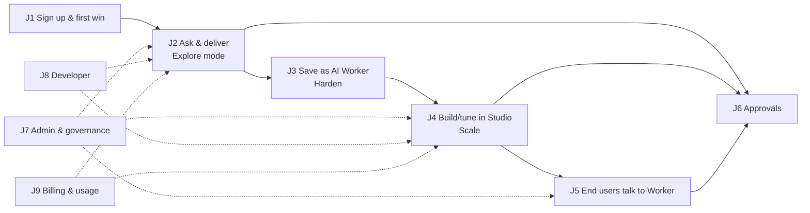
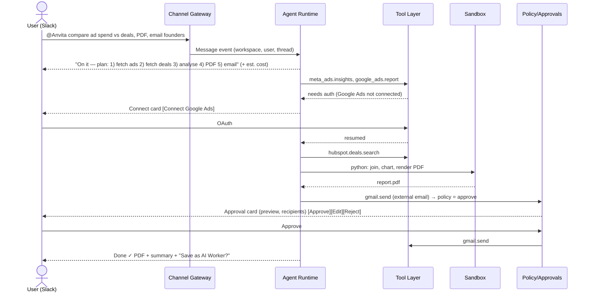

# Anvita AI — User Journeys (v0.1)

> Builds on `docs/anvita-ai-product-spec.md`. Each journey states the trigger, the step-by-step
> flow (what the user does, what Anvita does, which system components are involved), the success
> metric, and the edge cases. Component names match `docs/technical-architecture.md`.

## 0. Personas

| ID | Persona | Example | Main surface | Pattern borrowed from |
|---|---|---|---|---|
| P1 | **Team lead / founder** (SMB, 5–200 people) | Priya, founder of a D2C brand | Slack or WhatsApp, Web chat | Viktor |
| P2 | **Ops builder** (RevOps, HR ops, support ops) | Rahul, support operations manager | Web Studio | Ema |
| P3 | **Approver** | Sales lead, finance controller | Slack, Mobile, Email | Both |
| P4 | **Admin** (IT, security, compliance) | Anita, IT head | Admin console | Ema |
| P5 | **End customer / employee** talking to a Worker | A shopper on WhatsApp; an employee calling the IT line | WhatsApp, Voice, Web widget, Teams | Ema |
| P6 | **Developer** | Platform engineer | API, MCP, SDK | Both |

## 1. Journey map at a glance

The north-star loop is **J2 → J3 → J4**: ad-hoc work (Viktor-style) becomes reusable,
governed Workers (Ema-style).

---

## J1. Sign up and first win (P1, self-serve)

**Trigger:** lands on anvita.ai from an ad, a referral, or "Sent by Anvita" in a shared artifact.
**Goal:** first useful deliverable in **under 10 minutes**.

| # | User does | Anvita does | Components |
|---|---|---|---|
| 1 | Clicks "Start free" and signs in with Google or Microsoft | Creates Org and Workspace, grants trial credits (e.g. ₹2,000 / $25) | Auth (WorkOS/Clerk), Billing |
| 2 | Picks a home channel: **Slack**, **WhatsApp**, **Teams** or **Web only** | Starts the OAuth install for Slack or Teams; for WhatsApp, shows a QR code or number to message | Channel Gateway |
| 3 | Selects role and goals ("Marketing reports", "Customer support", "Sales follow-ups") | Recommends 3–5 integrations and 3 starter tasks | Onboarding service |
| 4 | Connects the apps (Google Workspace, HubSpot, Shopify…) using connect cards | Stores OAuth tokens in the vault and runs a quick read-only health check | Tool Layer, Secrets vault |
| 5 | *(Optional, consented)* "Let Anvita learn your workspace" | Reads selected channels and docs, builds the initial **workspace memory** (glossary, people, processes) and posts *"Here are 5 things I can take off your plate"* (Viktor pattern) | Memory service, Knowledge ingestion |
| 6 | Taps one suggestion, e.g. "Weekly sales summary" | Runs J2 and delivers the artifact | Agent Runtime, Sandbox |
| 7 | Invites teammates or adds Anvita to more channels | Sends invites; Anvita introduces itself in the channel | Channel Gateway |

**Success metrics:** time-to-first-artifact < 10 min; ≥ 2 integrations connected on day 1; D7 retention.
**Edge cases:**
- Slack admin approval is required → show a "Request install" message for the admin and keep the user productive in Web chat meanwhile.
- No integrations connected → suggest tasks that work on uploaded files or web research.
- WhatsApp sign-up → verify the phone by OTP, then link it to an email later for SSO and billing.

---

## J2. Ask and deliver — Explore mode (P1, P2)

**Trigger:** `@Anvita` in a channel or DM, a WhatsApp message, or Web chat.
**Example:** *"Compare last week's Meta + Google ad spend with HubSpot deals created, make a PDF and email it to the founders."*

| # | Step | Detail |
|---|---|---|
| 1 | **Acknowledge in < 2 s** | Typing indicator, then a short plan and a **cost estimate** (fixes Viktor's "credit burn surprise"). If the estimate is above the workspace threshold, ask before starting. |
| 2 | **Clarify only when needed** | Ask at most one clarifying question; otherwise assume sensible defaults and state them. |
| 3 | **Resolve connections** | Missing or expired auth → in-thread connect card; the run is *paused, not failed*, and resumes automatically. |
| 4 | **Execute** | Tool calls plus code in the workspace sandbox. Live progress is shown in a collapsible "What I'm doing" timeline (Web) or as thread updates (Slack and WhatsApp). |
| 5 | **Guardrails** | Each side-effecting action is checked against policies: allow, require approval, or deny (→ J6). |
| 6 | **Deliver** | Artifact (PDF, XLSX, chart, dashboard link, hosted mini-app) plus a 3-line summary and sources. Artifacts are stored and shareable with access control. |
| 7 | **Learn** | 👍/👎 and corrections ("we count revenue net of GST") are saved to memory with provenance, visible and editable in the Memory page. |
| 8 | **Offer to harden** | If the request looks repeatable (time words like "weekly", a repeated pattern, or ≥ 2 similar runs), show **"Save as AI Worker"** (→ J3). |

**Success metrics:** task success rate (👍 or no correction), median time to deliverable, cost per task, % of runs offered and accepted for hardening.
**Edge cases:** a tool rate limit leads to backoff and a user notice; a long job (> 5 min) runs in the background and posts back when done; an ambiguous recipient leads to a question; a sandbox crash means resume from the last checkpoint; credits run out mid-run so the run pauses with a top-up link.

---

## J3. Save as AI Worker — Harden (P1 → P2)

**Trigger:** the "Save as AI Worker" button, or *"@Anvita do this every Monday at 9"*.

| # | User does | Anvita does | Components |
|---|---|---|---|
| 1 | Clicks **Save as AI Worker** | **Run→Workflow Compiler** turns the run trace into a draft DAG: `trigger → tool steps → code step (frozen script) → agent step (summary) → approval → send` | Compiler, Workflow Engine |
| 2 | Reviews the draft in a compact card (Slack) or in Studio (Web) | Infers **parameters** (date range, recipients, accounts) and suggests a **schedule or trigger** | Studio API |
| 3 | Sets the schedule ("Mondays 09:00 IST"), owner, approvers and budget cap | Validates permissions: whose credentials will this use? Prompts to switch to a **service connection** or keep it **per-user** | Policy Engine, Tool Layer |
| 4 | Clicks **Test run** | Runs in a dry-run sandbox with side effects stubbed, then shows the outputs and diff vs. the original | Workflow Engine (test mode) |
| 5 | Clicks **Publish v1** | Versions the Worker, registers triggers, adds it to the Workers gallery | Worker registry, Scheduler |
| 6 | Receives scheduled output every Monday | Each run is logged; failures alert the owner with a "fix with Autopilot" link | Observability |

**Why this matters:** deterministic steps (data fetch, maths, formatting) become **code/tool
nodes** (cheap, repeatable, auditable). Only judgment steps stay as **agent nodes**. This gives
Ema-style reliability with Viktor-style creation.

**Edge cases:** a run used one-off context (a pasted file) so the compiler asks to turn it into a KB or input parameter; the run used the creator's personal Gmail so the user is asked to choose a shared connection; a non-deterministic agent step is wrapped with an output schema and validation.

---

## J4. Build or tune a Worker in Studio — Scale (P2)

**Trigger:** "New AI Worker" in Web, from a **template**, a **description** (Autopilot), or a **saved run** (J3).
**Example:** Rahul builds a *Customer Support Worker* for WhatsApp plus web widget, backed by Zendesk and Shopify.

| # | Stage | User does | Anvita does |
|---|---|---|---|
| 1 | **Start** | Picks the "Customer Support" template or types *"Answer order-status and return questions on WhatsApp, create Zendesk tickets for refunds > ₹5,000"* | **Autopilot** generates the DAG, required connections, KB slots, policies and a starter test set |
| 2 | **Knowledge** | Adds sources: help-center URL, Google Drive folder, returns-policy PDF | Ingests, chunks, embeds and sets up a sync schedule; shows coverage ("42 docs, 3 failed") |
| 3 | **Tools** | Connects Shopify (read orders) and Zendesk (create ticket) | Scopes actions to least privilege and marks write actions "approval required" by default |
| 4 | **Design** | Edits nodes on the canvas or tells Autopilot *"Escalate angry customers to a human"* | Adds a `classify_sentiment` agent node, a branch and a `handoff` node; explains the change |
| 5 | **Persona and channel** | Sets tone, languages (English, Hindi, Tamil), WhatsApp number, widget theme | Configures the interaction type (Chat), languages and channel bindings |
| 6 | **Test** | Runs the test set and chats in the playground | Evals: answer accuracy (LLM judge + citations), action correctness, safety; shows a scorecard and failing cases |
| 7 | **Publish** | Publishes v1 to 10% traffic, then 100% | Version pinning, canary, rollback |
| 8 | **Operate** | Watches the **Work Queue** and analytics; reviews flagged conversations | Surfaces failure clusters and suggests KB or prompt fixes (Autopilot "improve" loop) |

**Interaction types available:** Chat (Slack, Teams, WhatsApp, widget), **Work Queue** (batch items such as invoices or leads, with HITL review), **Voice**, **API**, **Document** (upload → extract → act).

**Success metrics:** time to publish (< 1 day for templates), eval pass rate ≥ target, containment or automation rate, cost per resolved item.

---

## J5. End user talks to a Worker (P5)

### J5a. WhatsApp customer
1. Customer messages the brand's WhatsApp number: *"Where is my order #1234?"*
2. Gateway maps the number to the Worker and identifies the customer (phone → Shopify customer).
3. The Worker fetches the order and answers in the customer's language with tracking link and ETA.
4. *"I want to return it"* → policy check → creates the return; above ₹5,000, an approval or human-handoff step runs.
5. Angry or unresolved → **handoff** to a human agent inbox (Zendesk or the Anvita Inbox) with a summary.
6. Optional CSAT prompt; the conversation is logged with PII redaction.

### J5b. Employee calls the IT helpline (Voice)
1. Calls the number (SIP via Exotel or Twilio); the Voice Worker greets in Hindi or English (auto-detect).
2. Real-time STT → agent → TTS with < 800 ms turn latency and barge-in support.
3. Verifies identity (employee ID + OTP to Slack or SMS) and resets the password via Okta or Azure AD.
4. Can't resolve → warm transfer to the human helpdesk with a transcript. **An escalation path is mandatory** (lesson from Ema's docs).

### J5c. Employee in Teams or Slack
An HR or IT Worker answers policy questions with **citations** to the handbook, and raises tickets
when asked.

---

## J6. Approvals (P3)

**Trigger:** a policy marks an action `approve` (external email, CRM write, payment, publish, data export).

| # | Step |
|---|---|
| 1 | The approver receives an **approval card** in their preferred channel (Slack DM, Teams, WhatsApp, email, mobile push) showing: who or what requested it, the action, a **diff or preview**, the reason, cost, and the expiry time |
| 2 | Options: **Approve**, **Edit & approve** (inline edit of the email or field values), **Reject with reason**, **Always allow this** (if their role allows creating rules) |
| 3 | Anvita resumes or cancels the run and notifies the requester |
| 4 | Expiry → escalate to the backup approver, or auto-reject per policy |
| 5 | Every decision is written to the **audit log** (actor, payload hash, timestamp) |

Multi-step chains (e.g. ≥ ₹1 lakh needs finance **and** CFO) are supported by the policy engine.

---

## J7. Admin and governance (P4)

| Area | What the admin does |
|---|---|
| Identity | Configure SAML or OIDC SSO, SCIM provisioning, domain capture |
| Roles | Owner / Admin / Builder / Member / Viewer, plus custom roles; Worker-level ACLs (who can use, edit or publish) |
| Connections | Approve which apps may be connected; workspace vs. per-user vs. shared connections; revoke tokens |
| Policies | Global action rules (deny `*.delete`, approve `email.send` to external domains), PII redaction, DLP patterns |
| Models | Model allow-list, data-residency region (IN / EU / US), "no-training" guarantee, BYO keys |
| Budgets | Monthly credit caps per workspace, Worker or user; alerts at 50/80/100% |
| Audit | Search and export the audit log (SIEM export via webhook or S3), conversation retention settings |
| Compliance | DPA download, sub-processor list, data export and deletion (DPDP and GDPR requests) |

---

## J8. Developer (P6)

1. Creates an API key (scoped to a workspace and Workers) in **Settings → Developers**.
2. Calls `POST /v1/chat/completions` (OpenAI-compatible, `model: "anvita"`) or `POST /v1/workers/{id}/runs`.
3. Connects Claude Code, Cursor or other MCP clients to the **Anvita MCP server** (`ask_anvita`, `run_worker`, `list_workers`, `get_run`) over OAuth.
4. Registers a **custom tool** (OpenAPI spec or an MCP server URL) that becomes available to the agent and the Studio.
5. Subscribes to webhooks (`run.completed`, `approval.requested`, `worker.failed`).

---

## J9. Billing and usage (P1, P4)

1. Trial credits → in-product meter (always visible in the Web header and with `/anvita usage` in Slack).
2. Every run shows its **actual cost** next to the estimate; Worker pages show **cost per outcome**.
3. At 80% of credits → notification; at 100% → runs pause (scheduled Workers can draw on an optional overdraft).
4. Plans: Free trial → **Team** (monthly credits per workspace) → **Business** (SSO, Studio, more channels) → **Enterprise** (outcome-based pricing, VPC, SLAs). Payment via Stripe or Razorpay (India, UPI).

---

## 10. Cross-journey UX principles
1. **Meet users where they work.** Chat first; Web for building and admin.
2. **Never fail silently.** Pause and ask (auth, approval, credits) instead of failing.
3. **Show your work.** Plan, live steps, sources and cost on every run.
4. **Safe by default.** Writes need approval until an admin or owner relaxes the rule.
5. **Everything becomes reusable.** Any good run is one click from being a Worker.
6. **Multilingual by default.** English plus Indic languages in text and voice.
